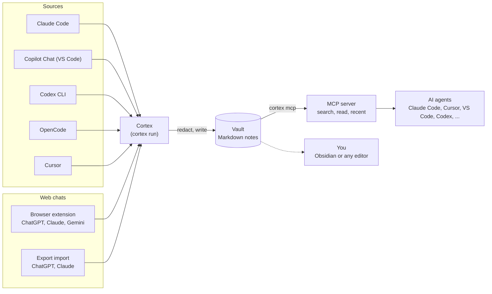

<div align="center">


# Cortex

**One local memory for all your AI tools.**<br>
Cortex saves every conversation you have with AI tools as Markdown notes in a single folder, and lets any AI agent search that folder.

[](https://github.com/marioolf/cortex/actions/workflows/ci.yml)
[](go.mod)
[](LICENSE)


<!-- Add a release badge after v0.1.0: [](https://github.com/marioolf/cortex/releases) -->

[Why Cortex](#why-cortex) ·
[Install](#install) ·
[Quick start](#quick-start) ·
[Connect your AI tools](#connect-your-ai-tools-mcp) ·
[Web chats](#web-chats) ·
[Privacy & security](#privacy--security) ·
[FAQ](#faq)

</div>

---

## Why Cortex

The context you build up with AI tools ends up scattered across their private storage: a Claude Code session here, a Copilot chat there, a ChatGPT thread in a browser tab. None of it is searchable together, and none of it is yours to read.

Cortex gathers it in one place you control:

- a **folder of plain Markdown notes** (the vault) that you can read yourself, open with [Obsidian](https://obsidian.md/) or any Markdown reader, sync or back up however you like;
- a **small background program** with a local control panel that keeps the folder up to date;
- an **MCP server**, so that Claude Code, Cursor, VS Code, Codex CLI and other agents can look up what you discussed with any other tool. All your tools share one memory.

Everything runs on your machine. There is no account and no cloud service. Nothing leaves your computer, unless you switch on the optional summaries (off by default, see [Summaries](#summaries)).

## Features

- **Many sources, one vault.** Claude Code, GitHub Copilot Chat in VS Code, Codex CLI, OpenCode and Cursor are read from disk; ChatGPT and Claude (web) from an export file; ChatGPT, Claude and Gemini (web) through a browser extension.
- **Runs in the background.** Saves everything once, then checks again every 30 seconds. Starts at login if you want it to (Windows tray icon included).
- **Local control panel** at `127.0.0.1`: pause and resume, choose the vault, switch sources and projects on and off, import exports, pair the extension, connect your AI tools.
- **MCP server** (`cortex mcp`) with three read-only tools: `search`, `read` and `recent`.
- **Plain, durable notes.** One note per conversation, organised by project. You can rename, move or annotate notes; Cortex only rewrites its own block.
- **Secrets are redacted** before a note is written (private keys, API keys, tokens, passwords, your own patterns).
- **Optional summaries** of finished conversations, written by an AI tool you already have installed.
- **Single binary**, no runtime, no telemetry, no update checks.

<div align="center">

<br>
<sub>The control panel, with invented sample data.</sub>
</div>

## How it works



`cortex run` watches the folders where the tools keep their sessions, writes one note per conversation into the vault, and serves the control panel. The browser extension and imports feed the same vault. `cortex mcp` is started by your AI tool when it needs it; it reads the notes straight from the folder and never writes.

## Supported sources

| Source | How it is read | Checked against |
|---|---|---|
| Claude Code (CLI and desktop) | session files on disk | real sessions |
| GitHub Copilot Chat in VS Code | session files on disk | the VS Code source and real session files without messages |
| Codex CLI | session files on disk, including compressed `.jsonl.zst` sessions | its source code only |
| OpenCode | its local storage | its source code only |
| Cursor | its local storage | community descriptions of its storage only |
| ChatGPT (web) | import of an export | community descriptions of the export format and invented samples only; no real export |
| Claude (web) | import of an export | community descriptions of the export format and invented samples only; no real export |
| ChatGPT, Claude and Gemini (web) | browser extension | invented HTML only; never run against the live sites or in a real browser |

Everything below Claude Code and Copilot has only been tested with made-up samples. Expect rough edges, and please [report sessions that come out wrong](https://github.com/marioolf/cortex/issues/new?template=bug_report.md). Gemini has no export that Cortex reads; use the extension.

## Install

> [!NOTE]
> There is no tagged release yet. Until the first one is published, [build from source](#build-from-source) (one `go build` command).

Download the file for your system from the [Releases page](https://github.com/marioolf/cortex/releases), next to `checksums.txt` (SHA-256 of every file; compare with `sha256sum -c checksums.txt --ignore-missing`, or with `Get-FileHash` on Windows). Releases are not code-signed yet, so Windows and macOS warn about the program. Full details, including the exact warnings, are in [docs/install.md](docs/install.md).

### Windows

1. Download `cortex_VERSION_windows_amd64.zip` (`arm64` for ARM machines) and unzip it.
2. Double-click `cortex.exe`. Windows SmartScreen will most likely stop it with "Windows protected your PC" and an "Unknown publisher". This happens because the program has no code-signing certificate and is new to Microsoft's reputation system, not because SmartScreen found anything in it. Click **More info**, then **Run anyway**. If you would rather not run a program you cannot verify, [build it from source](#build-from-source).
3. Your browser opens the control panel. Click **Install** at the top: Cortex copies itself to `%LOCALAPPDATA%\Programs\Cortex\cortex.exe`, adds a Start Menu shortcut, registers itself to start at login and restarts from there. (`cortex.exe install` does the same from a terminal.)

Cortex has no window of its own: look for its icon in the notification area. A click opens the panel; the right-click menu has Open Cortex, Pause/Resume and Quit.

### macOS and Linux

Download `cortex_VERSION_darwin_arm64.tar.gz` (Apple silicon), `darwin_amd64` (Intel), `linux_amd64` or `linux_arm64`, extract it, put `cortex` in a folder on your `PATH` (for example `~/.local/bin`) and run `cortex`. There is no installer on these systems yet. The first `run` registers Cortex to start at login (a launch agent on macOS, an XDG autostart entry on Linux) for the binary's location at that moment, so put it in its final place first, or pass `-no-autostart`.

macOS Gatekeeper blocks programs that are not signed and notarized when they carry the "quarantine" mark that browsers put on downloads. A file extracted with `tar` in the Terminal does not usually get the mark; one opened from Finder may be refused. If you decide to trust the file, allow it in System Settings, Privacy & Security ("Open Anyway"), or run `xattr -d com.apple.quarantine /path/to/cortex`. (This wording comes from Apple's documentation and has not been checked on a Mac.) More in [docs/install.md](docs/install.md#macos-and-linux).

## Quick start

```
cortex            # same as `cortex run`: saves everything, keeps watching, opens the panel
```

1. Start Cortex. It saves every conversation it finds, then checks again every 30 seconds. The panel opens at `http://127.0.0.1:47821/`.
2. Open the vault (default `~/Cortex`, or **Open folder** in the panel) in Obsidian or any Markdown reader.
3. [Connect your AI tools](#connect-your-ai-tools-mcp) so that they can search it.

`cortex sync` does one round and exits. Other commands: `import`, `summarize`, `mcp`, `install`, `uninstall`, `version`. Options for `run` (`-no-browser`, `-port`, `-no-autostart`, `-no-tray`, `-config`) and everything the panel does are described in [docs/build-and-run.md](docs/build-and-run.md#run).

A note looks like this ([more on the format](docs/notes.md)):

```markdown
---
source: "claude-code"
session: "0b6c1f2e-..."
project: "myapp"
cwd: "/home/me/code/myapp"
started: 2026-05-01T09:30:00Z
generated: true
---

# Fix the login redirect

<!-- cortex:start -->
## User · 2026-05-01 11:30

Why does the login page redirect twice?
...
<!-- cortex:end -->
```

## Connect your AI tools (MCP)

`cortex mcp` is a [Model Context Protocol](https://modelcontextprotocol.io/) server over the vault. It speaks JSON-RPC on stdin and stdout, reads the notes straight from the folder, never writes anything and does not need `cortex run` to be running: the AI tool starts it when it needs it.

Three read-only tools:

| Tool | What it does |
|---|---|
| `search` | All words must appear (case-insensitive) in the title or text; optional `project`, `source`, `since`, `limit`. Best matches first, with snippets. |
| `read` | Reads a note returned by `search` or `recent`, in parts if it is long. Only `.md` files inside the vault. |
| `recent` | The most recently changed notes, optionally for one project or source: "what was I working on?" |

The easiest way: open the panel's **Connect your AI tools** section. It shows, for each tool, what to do with the path of the Cortex program that is running, and has one-click **Add to Claude Desktop** and **Add to Cursor** buttons. By hand:

```sh
# Claude Code
claude mcp add --scope user cortex -- '/path/to/cortex' mcp
```

```toml
# Codex CLI, in ~/.codex/config.toml
[mcp_servers.cortex]
command = "/path/to/cortex"
args = ["mcp"]
```

Claude Desktop, Cursor, VS Code and OpenCode have their own snippets, and there is a paragraph to paste into `CLAUDE.md` or `AGENTS.md`: see [docs/mcp.md](docs/mcp.md#connecting-a-tool). Results are marked as data, not instructions, to lower the risk of prompt injection through an old conversation; this does not remove it.

## Web chats

ChatGPT, claude.ai and Gemini keep your conversations on their servers, so Cortex gets them in two other ways:

- **Import an export** (ChatGPT, Claude): `cortex import FILE`, or the panel's **Web chats** section. Importing the same file twice changes nothing.
- **Browser extension** (ChatGPT, Claude, Gemini; Chrome, Edge, Brave): the [`extension/`](extension/README.md) folder, loaded unpacked (it is not in any browser store yet). It talks only to Cortex on `127.0.0.1` and proves itself with a pairing code.

Both write the same notes as every other source, and a conversation that arrives both ways is one note. Details, limits and the pairing flow: [docs/web-chats.md](docs/web-chats.md) and [extension/README.md](extension/README.md).

## Summaries

Optional, and **off by default**. When a conversation has been quiet for a while, Cortex can have an AI tool write a short summary and store it at the top of the note. The text of the conversation is piped to the tool you choose (Claude Code or Codex CLI, or a custom command you write in the config file), which sends it to its own AI provider and uses your account there. Cortex itself contacts nothing. Do not switch this on for projects whose conversations must not go to that provider. See [docs/summaries.md](docs/summaries.md) for the exact commands, limits and what is locked down.

## Configuration

Optional: Cortex works without a config file. It is a JSON document in the OS config directory (`~/.config/cortex/config.json` on Linux, `%AppData%\cortex\config.json` on Windows, `~/Library/Application Support/cortex/config.json` on macOS), and the panel writes it when you change a setting.

```json
{
  "vault": "/home/me/notes/Cortex",
  "disabled_sources": ["claude-code"],
  "excluded_projects": ["secret-client"],
  "redact_patterns": ["ACME-[0-9]{8}"],
  "paused": false
}
```

Every field, including `extension_token` and the `summaries` block, is in [docs/configuration.md](docs/configuration.md). `run` also keeps a log, `cortex.log`, in the same folder.

## Privacy & security

- **Local only.** Everything stays on your machine. The one optional exception is [summaries](#summaries).
- **No network by default.** Cortex never checks for updates or contacts the Internet. The panel listens on `127.0.0.1` and only accepts connections from your own machine.
- **Redaction.** Before a note is written, secrets are replaced with `[REDACTED]`: private key blocks, API keys and tokens with well-known prefixes, JSON Web Tokens, `Authorization` header values, values assigned to names such as password or secret, `--password VALUE` style flags, passwords in URLs, and any patterns you add. It is best-effort and will miss things: be careful with a synced or shared vault. Details in [docs/privacy.md](docs/privacy.md).
- **Tool output and model thinking are not saved**; tool calls are kept as one line each.
- **Notes are data.** They can quote text written by third parties; an agent reading the vault should treat them as data, not instructions.
- **Pairing code.** The extension's `extension_token` in the config file is like a password: whoever has it, and can reach `127.0.0.1`, can add notes to your vault.

## Update / Uninstall

Cortex never checks for updates. To update on Windows, run the new `cortex.exe` while the installed one is running: it asks the running Cortex to quit and starts in its place, and the panel's **Install** banner replaces the installed file. On macOS and Linux, replace the `cortex` file. To uninstall on Windows, run `cortex uninstall` (add `-purge` to also remove the config file and the log); the vault is never removed, so delete it yourself if you want the notes gone. On macOS and Linux, turn off "Start Cortex when I log in" in the panel and delete the binary. The long version, with every edge case: [docs/install.md](docs/install.md#update).

## Build from source

You need Go, at the version given in [`go.mod`](go.mod).

```sh
go build -o cortex ./cmd/cortex
./cortex
```

On Windows, build with `-ldflags "-H windowsgui"` so that starting Cortex at login or by double click opens no console window (this is how releases are built; `scripts/release.sh VERSION OUTDIR` builds and packages all of them, reproducibly):

```sh
go build -ldflags "-H windowsgui" -o cortex.exe ./cmd/cortex
```

The Windows icon, version information and manifest are embedded from the committed `cmd/cortex/rsrc_windows_*.syso` files (generated for version 0.0.0 with the standard library only: `go run ./tools/winres -ico winres/cortex.ico -version 0.0.0 -out-dir cmd/cortex`; the release script regenerates them with the release version).

Notes on that build (how `cortex.exe sync` behaves in PowerShell, where the log goes, start failures) are in [docs/build-and-run.md](docs/build-and-run.md#build-from-source).

## Status & roadmap

Early development. Cortex captures conversations from the sources above, either once with `cortex sync` or continuously with `cortex run`. Honestly:

- **Verified against real data:** Claude Code sessions and, partly, Copilot Chat session files (without messages). Everything else was written from source code or documentation and tested with invented samples.
- **Web chats:** the extension's selectors come from open-source exporters and have **not been tested against the live sites** or in a real browser; the sites change their HTML without notice. The import formats have not been tried against a real export.
- **Windows:** the installer, tray icon, start at login and the SmartScreen flow have not been verified by hand on a real Windows machine (the test suite and builds run on Windows in CI). The macOS Gatekeeper text has not been checked on a Mac.
- **Not yet:** code-signed releases, an extension in the browser stores, an installer on macOS and Linux, and a first tagged release.

Bug reports with a bit of the log are the most useful help right now.

## FAQ

**Does anything leave my computer?**
No, unless you switch on summaries, which send the conversation text to the AI tool you choose. Cortex makes no other network connections: it listens only on `127.0.0.1`.

**Where are my notes?**
In the vault folder, `~/Cortex` by default. Change it in the panel. Notes are plain Markdown; [here is the format](docs/notes.md).

**Can I edit or move the notes?**
Yes. Text outside the `cortex:start` and `cortex:end` markers is kept, and renamed or moved notes are found again through the `session` line in the frontmatter.

**What if I delete a note?**
Cortex writes it again the next time its conversation changes or Cortex restarts. To stop capturing something for good, turn its project or source off in the panel. See [docs/notes.md](docs/notes.md).

**Does Cortex capture my passwords?**
It redacts common secret formats before writing, but redaction is best-effort. See [docs/privacy.md](docs/privacy.md).

**Why does Windows or macOS warn me about it?**
Releases are not code-signed yet. See [Install](#install).

**Can I stop it capturing a project?**
Yes: turn the project off in the panel, or list it in `excluded_projects`. Notes already written are never deleted.

## Contributing

Issues and pull requests are welcome; see [CONTRIBUTING.md](CONTRIBUTING.md). Before sending a change:

```sh
go vet ./...
go test ./...
cd extension && node --test
```

Please use the [bug report template](https://github.com/marioolf/cortex/issues/new?template=bug_report.md) and remove private content from anything you paste.

## License

[MIT](LICENSE). The licences of the Go modules and the Go standard library compiled into the program are in [THIRD_PARTY_LICENSES.md](THIRD_PARTY_LICENSES.md) (generated by `scripts/licenses.sh`, which CI checks against the committed file); every release archive contains that file.
